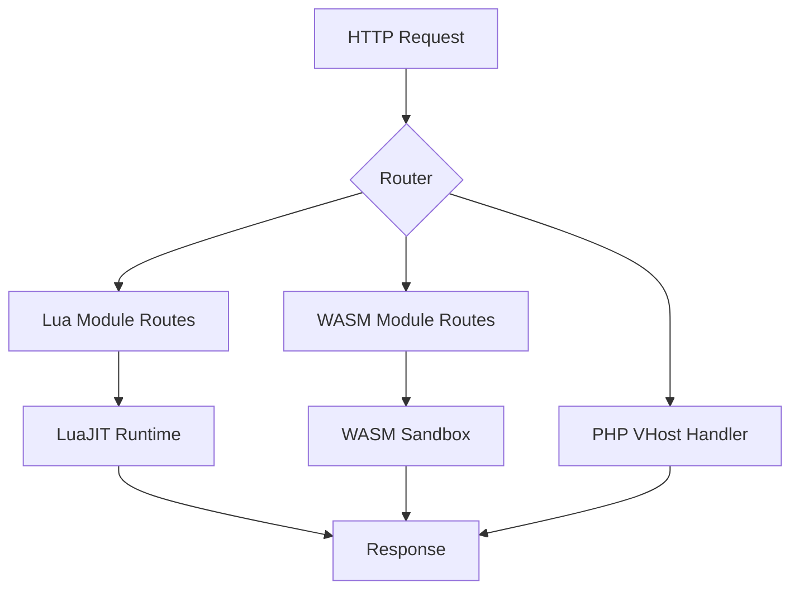

# Modules Architecture (LarvaPHP v2)

## Overview

## Architecture Diagram




LarvaPHP v2 supports two native module forms:

1. **Lua modules** (embedded LuaJIT via `mlua`) — flexible, can intervene at
   any layer of the request pipeline.
2. **WASM modules** (WebAssembly) — sandboxed extensions.

Modules can register HTTP routes, hooks, middleware, and workers without
requiring PHP application code.

## Loading a Lua module

```lua
-- example.lua
larva.route("GET", "/api/hello", function(req)
    return { status = 200, body = "Hello from Lua" }
end)
```

Loaded via `larva_php::modules::lua::load_lua_module(path)`.

## Security considerations (CRITICAL)

- Lua modules run in-process with full host privileges. Only load modules from
  trusted sources.
- Never load untrusted `.lua` or `.wasm` files from user uploads.
- Validate and sandbox module paths; restrict to a configured modules directory.
- WASM modules are the safer option for untrusted code (sandboxed).
- Disable module loading in production unless explicitly configured.
- Audit all module code; modules can read/write filesystem and network.
- Use role-based access to the panel's module management endpoints.
